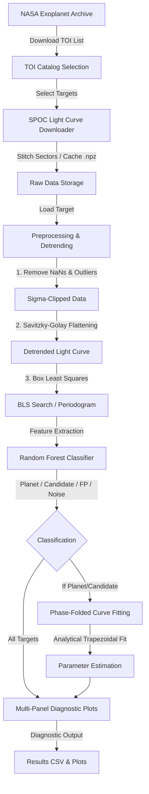

# TESS Exoplanet Detection & Classification Pipeline

An automated scientific pipeline designed to download, preprocess, detect, and classify exoplanet transit candidates from the **Transiting Exoplanet Survey Satellite (TESS)** high-cadence data. 

The pipeline uses the **Box Least Squares (BLS)** periodogram for transit detection, fits an analytical trapezoidal model using non-linear least-squares optimization for parameter estimation, and implements a **Random Forest Classifier** to distinguish genuine exoplanets from astrophysical false positives (e.g., eclipsing binaries, blends) and instrumental noise.

---

## 🌌 Pipeline Architecture & Workflow



---

## 🛠️ Features & Methodology

### 1. Light Curve Preprocessing (`src/preprocessing.py`)
To isolate transit signals, stellar variability and instrumental systematics must be filtered out:
* **Outlier Rejection:** Removes cosmic rays and non-physical spikes using statistical $\sigma$-clipping (default: $5\sigma$).
* **Flattening / Detrending:** Fits the stellar variability trend using a **Savitzky-Golay (SG) filter** with a customizable window length, then normalizes the light curve centered at $1.0$ (relative flux).

### 2. Period Search (`src/dip_detection.py`)
Uses the **Box Least Squares (BLS)** algorithm from `astropy.timeseries` to search for periodic, box-like dips in the light curve:
* **Grid Optimization:** Automatically scales the period search range based on the baseline of observations to prevent performance bottlenecks.
* **Secondary Eclipse Search:** Folds the light curve and checks the phase region around $\phi = 0.5$ to calculate the depth of any secondary eclipse, crucial for identifying Eclipsing Binaries (EBs).

### 3. Machine Learning Classification (`src/classifier.py`)
A `RandomForestClassifier` parses the light curve metrics and stellar properties to assign a classification label (`Planet`, `Eclipse` (EB), `Blend`, or `Noise`).
* **Engineered Features:**
  * `bls_period`, `bls_depth`, `bls_duration`, `bls_snr`, and `bls_significance` (peak power vs. mean noise).
  * `st_rad`, `st_mass`, and `st_teff` from the TIC (TESS Input Catalog) metadata.
  * **Estimated Planet Radius ($R_\oplus$):**
    $$R_p = R_* \sqrt{\delta} \times 109.2$$
    where $\delta$ is the fractional transit depth and $R_*$ is the stellar radius in solar units.
  * **Transit Duration Ratio:** Compares observed duration to the theoretical transit duration $T_{\text{dur}}$ for a circular, edge-on orbit:
    $$T_{\text{dur}} = \frac{R_* P}{\pi a}$$
    where semi-major axis $a$ is derived via Kepler's Third Law:
    $$a^3 = \frac{G M_* P^2}{4 \pi^2}$$
  * **Secondary-to-Primary Depth Ratio:**
    $$\text{Ratio} = \frac{\text{depth}_{\text{secondary}}}{\text{depth}_{\text{primary}}}$$

### 4. Analytical Parameter Estimation (`src/parameter_estimation.py`)
Fits an analytical **trapezoidal transit model** to the phase-folded light curve using `scipy.optimize.curve_fit` (non-linear least-squares):
* Fits for transit center offset ($t_0$), depth ($\delta$), transit duration ($T_{14}$), and ingress/egress duration ($T_{12}$).
* Computes standard errors (uncertainties) for all fitted physical parameters directly from the covariance matrix.

### 5. Diagnostics & Visualization (`src/visualization.py`)
Generates high-resolution 4-panel diagnostic plots for each target containing:
1. **Raw Light Curve:** Showcases the original SPOC flux overlaid with the Savitzky-Golay flattening trend.
2. **Detrended Light Curve:** Highlights the exact positions of the detected transits across the temporal baseline.
3. **BLS Power Spectrum:** Displays the spectral power vs. period (days) indicating the peak periodicity.
4. **Phase-Folded Zoom:** Shows the folded light curve zoomed-in around the transit window, complete with binned median points and the analytical trapezoidal fit model.
5. **Metadata Overlay:** Includes catalog parameters, BLS details, and final fitted metrics with uncertainties.

---

## 📂 Project Directory Structure

```text
ISRO/
├── main.py                    # Main pipeline entry point script
├── requirements.txt           # External dependencies
├── src/                       # Source modules
│   ├── classifier.py          # Feature extraction and Random Forest model
│   ├── data_loader.py         # TOI table retrieval and light curve caching
│   ├── dip_detection.py       # Box Least Squares periodogram and phase folding
│   ├── parameter_estimation.py# Analytical trapezoidal fitting models
│   ├── preprocessing.py       # Light curve cleaning and detrending
│   ├── tests/                 # Unit tests
│   │   └── test_pipeline.py   # Test suite for preprocessing, BLS, and fitting
│   └── visualization.py       # 4-panel diagnostic plot generator
├── data/                      # Data cache & outputs directory (auto-created)
│   ├── raw/                   # Downloaded .npz SPOC light curves
│   ├── processed/             # Extracted features datasets
│   ├── outputs/               # Diagnostic plots & pipeline_summary.csv
│   ├── toi_list.csv           # TOI catalog downloaded from NASA Exoplanet Archive
│   └── classifier_model.pkl   # Serialized Random Forest classifier
└── scratch/                   # Developer scripts & scratchpads
```

---

## 🚀 Installation & Setup

### Prerequisites
Make sure you have Python 3.9+ installed on your system.

### Virtual Environment Setup
1. Navigate to the project directory:
   ```bash
   cd /Users/tushar/ISRO
   ```

2. Activate the existing virtual environment:
   ```bash
   source .venv/bin/activate
   ```

3. Install the required dependencies:
   ```bash
   pip install -r requirements.txt
   ```

---

## 💻 Usage

### Running the Pipeline
Execute the full pipeline using the virtual environment's python interpreter:

```bash
python main.py [options]
```

#### Available Options:
* `--targets <int>`: Number of targets to download and process (default: `15`).
* `--force`: Force a fresh re-download of the NASA Exoplanet Archive TOI list.
* `--sector <int>`: Filter TESS targets from a specific sector (optional).

#### Example:
Run the pipeline for 10 targets in TESS Sector 1:
```bash
python main.py --targets 10 --sector 1
```

### Outputs
Once execution completes, check the following directories:
* **`data/outputs/`**: Contains diagnostic plots (`tic_<id>_diagnostic.png`) and `pipeline_summary.csv` summarizing final transit metrics, predictions, and physical estimates.
* **`data/processed/`**: Holds `features.csv` which contains the extracted feature set used for ML training.
* **`data/classifier_model.pkl`**: The trained classifier binary.

---

## 🧪 Testing

To run the pipeline unit tests, execute:

```bash
python -m unittest src/tests/test_pipeline.py
```

The test suite validates:
1. **Preprocessing:** NaN handling, outlier rejection, detrending limits.
2. **BLS Search:** Period and transit depth recovery.
3. **Phase Folding:** Alignment and sorting accuracy.
4. **Parameter Estimation:** Trapezoid model fitting convergence and boundaries.
5. **Feature Extraction:** Theoretical transit duration calculations and radius estimations.
